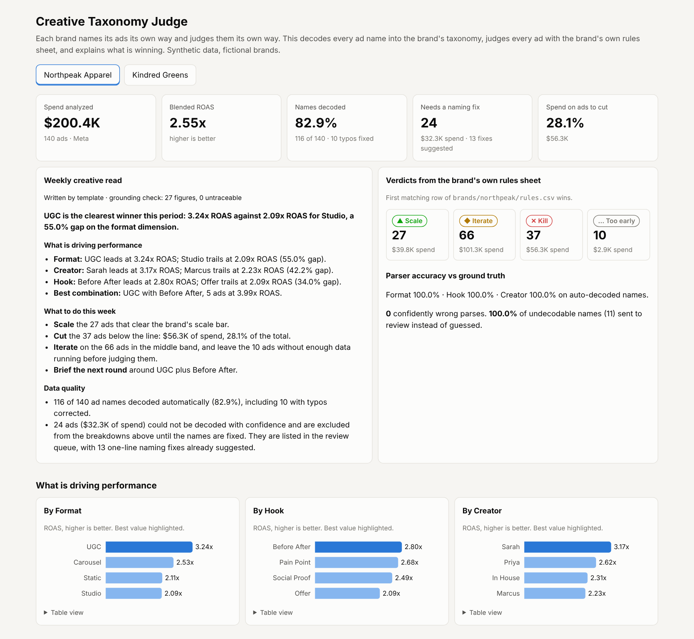

# Creative Taxonomy Judge

**Every brand names its ads its own way and judges them its own way. This makes one AI workflow fit each brand's quirks without writing new code for every customer.**

A brand's ad export is full of names like `UGC_PainPoint_Sarah_v3`, `ugc-pp-sarah-V03`, `Staitc_PainPoint_Marcus_v1` and `new video final`. Another brand writes `2026-09 | Jen | Founder Story | Talking Head | 15s`. Before anyone can answer "which hooks are working?", someone has to decode those names into the brand's own taxonomy, judge each ad the way that brand judges ads, and explain the result in plain language.

This project does that end to end, for two fictional brands with completely different conventions:

```
platform exports (Meta, TikTok)
        │
        ▼
decode ad names ─── exact match ─► fuzzy match for typos ─► conflict or missing field?
        │                                                        │
        │                                          optional LLM fallback, validated
        │                                          against the brand's allowed values
        │                                                        │
        │                                          still unsure? → review queue with a
        │                                          suggested one-line naming fix
        ▼
judge every ad with the brand's own rules sheet (rules.csv, first matching row wins)
        │
        ▼
what is driving performance: by hook, format, creator, and best combinations
        │
        ▼
weekly memo (Claude or template) ──► grounding check: every figure must trace to metrics.json
        │
        ▼
dashboard.html
```



## Results on the synthetic data

| | Northpeak Apparel | Kindred Greens |
|---|---|---|
| Naming convention | `FORMAT_HOOK_CREATOR_vN` | `MONTH \| CREATOR \| HOOK \| FORMAT \| LENGTH` |
| How the brand judges ads | ROAS: scale at 2.8x, breakeven 2.0x, video must hit a 25% hook rate | CPA: scale at $38 with healthy CTR, kill above $50 |
| Platforms | Meta | Meta and TikTok, different column names |
| Ads / spend | 140 / $200.4K | 110 / $165.4K |
| Names decoded automatically | 116 (82.9%), 10 typos corrected | 98 (89.1%), 4 typos corrected |
| Field accuracy on decoded names | 100% format, hook, creator | 100% creator, hook, format |
| **Confidently wrong parses** | **0** | **0** |
| Undecodable names caught, not guessed | 11 of 11 | 8 of 8 |
| Review queue / suggested naming fixes | 24 / 13 | 12 / 4 |
| Clearest driver found | UGC 3.24x ROAS vs Studio 2.09x | No-creator ads $32.65 CPA vs Jen $45.11 |

Accuracy is measured in `judge/evaluate.py` against `data/ground_truth.csv`, which the generator writes and the pipeline never reads. The data includes realistic mess on purpose: mixed separators and casing, abbreviations, typos, `COPY` suffixes, spellings the brand config has never seen, names that list two hooks, and names nobody could decode.

## Why it's built this way

**Deterministic first, AI where it earns its place.** Most ad names are decodable with the brand's own vocabulary plus typo tolerance. That part is rules, so it is fast, free, testable and explainable. The LLM is only asked about the names the rules could not resolve.

**Being wrong quietly is worse than saying "I don't know".** A mis-decoded ad silently pollutes every breakdown. So the parser has three outcomes: trusted, LLM-decoded and flagged for a spot-check, or sent to review. The number I watch is "confidently wrong", not "coverage". When the LLM answers, its values must exist in the brand's taxonomy; an invented value such as `hook=CURIOSITY_GAP` is rejected and the ad goes to review.

**The review queue teaches the system.** When a name is missing exactly one field and has one unknown token left, the queue proposes the fix: `'staitc' looks like format STATIC` or `'internal' is a new creator spelling: map it to a creator value`. One line in `taxonomy.yaml` and that spelling decodes for every future ad. This is how a custom fix for one customer becomes something the whole team can reuse.

**The brand's spreadsheet is the spec.** `rules.csv` is the kind of sheet a growth team already keeps: ordered rows of condition, verdict and reason. Conditions run through a small whitelist parser (comparisons, and/or/not, known metric names), not Python `eval`, so a customer-edited sheet cannot run code. Missing metrics never match, so a static image is never judged on a video hook rate.

**A new brand is configuration, not code.** Each brand is a folder: `taxonomy.yaml` (export column mapping, fields, spellings) and `rules.csv`. A test onboards a third brand from config alone.

**Numbers in the memo must be real.** Claude can draft the weekly memo, but `judge/grounding.py` parses every figure with its unit and precision and blocks the memo if any number does not trace back to `metrics.json`. If a draft fails, the deterministic template is used instead.

## Run it

```bash
pip install -r requirements.txt
python generate_data.py      # synthetic exports + ground truth
python run.py                # decode, judge, summarize, memo, eval → output/
python build_dashboard.py    # output/dashboard.html
pytest -q                    # 15 tests
```

With `ANTHROPIC_API_KEY` set, the LLM fallback decodes review-queue names and Claude drafts the memo; both are validated before use. Without a key, everything runs offline: unresolved names go to review and the memo comes from the template. The committed outputs were produced offline.

## Layout

| Path | What it is |
|---|---|
| `brands/<brand>/taxonomy.yaml` | export column mapping, required fields, allowed values and team spellings |
| `brands/<brand>/rules.csv` | the brand's own judging rules |
| `judge/taxonomy.py` | name parser: exact, fuzzy, conflict and missing-field handling |
| `judge/llm.py` | LLM fallback prompt and strict validation of the answer |
| `judge/rules.py` | safe rules-sheet evaluator |
| `judge/pipeline.py` | exports → decoded and judged ads → metrics and naming-fix suggestions |
| `judge/memo.py`, `prompts/weekly_memo.md` | weekly memo, Claude or template |
| `judge/grounding.py` | figure-level grounding check |
| `judge/evaluate.py` | parser accuracy against ground truth |
| `output/` | per-brand ads, review queue, metrics, memo; `eval.json`; `dashboard.html` |

## Limitations

- **Synthetic data.** Two fictional brands with seeded noise; real exports will surprise it in new ways.
- **The LLM paths have not been run against a live model in this repo.** They are implemented, and the validation is tested with stubbed responses, including an invented value and malformed JSON.
- **Correlation, not causation.** "UGC beats Studio" is a pattern in this period's spend, not a controlled test. Small groups (a combination with five ads) should be read as a lead to test, not a conclusion.
- **The fuzzy threshold is a tradeoff.** At 0.85 it catches `SocialProf` but sends `Staitc` to review. Lowering it decodes more names and raises the risk of a confident mistake.

## What I would hand to Engineering if this proved out

- **Connectors:** pull from the Meta and TikTok marketing APIs instead of CSV exports.
- **Accept-a-suggestion button:** turn the review queue's naming fixes into a one-click config update, with an audit trail.
- **Per-brand eval sets:** keep a small labeled sample per customer so taxonomy changes are tested before they ship.
- **Significance flags:** minimum spend and sample size before a driver is called a winner.
- **Schedule it:** a weekly run that posts the memo to the brand's Slack, for example with n8n.

All data is synthetic. Northpeak Apparel, Kindred Greens, Copperleaf Home and every creator named here are fictional.
